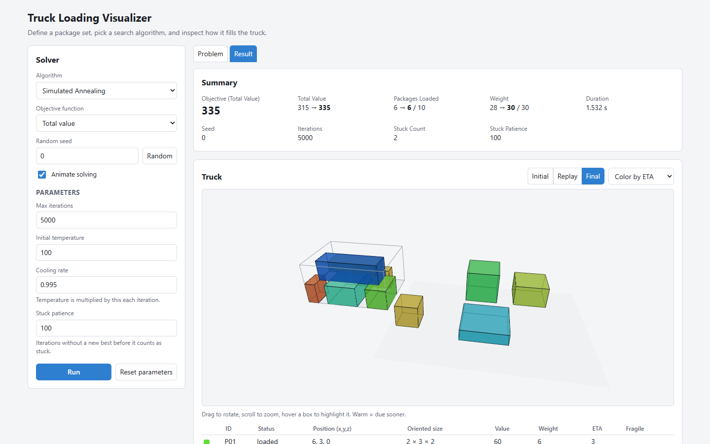
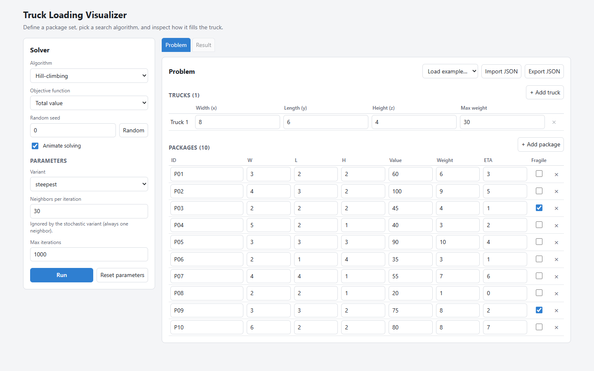

# IF3170_G11_ThreeAgents

Implementasi Tugas Besar 1 IF3170 Inteligensi Artifisial: pencarian konfigurasi paket pada truk menggunakan Hill-climbing, Simulated Annealing, dan Genetic Algorithm.



## Overview

Program ini mencari konfigurasi pemuatan paket tiga dimensi ke dalam truk dengan *local search*. Setiap paket memiliki dimensi, nilai, berat, ETA, dan status *fragile*; program memilih paket yang dimuat beserta posisi dan orientasinya sehingga total nilai maksimal tanpa melanggar batas ruang truk, kapasitas berat, penopang (*support*), dan aturan paket *fragile*. Pencarian dilakukan dengan Hill-climbing, Simulated Annealing, dan Genetic Algorithm di atas representasi state, validator, dan fungsi neighbor yang sama.

## Program Features

- **Hill-climbing** dengan empat varian: steepest ascent, sideways move, stochastic, dan random restart.
- **Simulated Annealing** dengan pendinginan geometrik, probabilitas penerimaan $e^{\Delta E/T}$, dan deteksi *stuck*.
- **Genetic Algorithm** dengan roulette-wheel selection, single-point crossover beserta repair, dan mutasi.
- **Tiga objective function**: `total_value`, `eta_weighted_value`, dan `compact_value`.
- **Multi-truk**: HC, SA, dan GA berjalan pada armada truk identik maupun heterogen.
- **Runner eksperimen dan benchmark** yang mencatat seed, parameter, riwayat objective, durasi, serta visualisasi state awal dan akhir.
- **Visualizer web**: editor problem, pemilihan algoritma dan parameter, tampilan 3D truk, grafik progres pencarian, dan animasi proses solving.

## Dependencies & Prerequisites

- Python **3.10 atau lebih baru**.
- Dependency eksperimen dan plot (`matplotlib`) di `requirements.txt`.
- Untuk visualizer web: dependency server (FastAPI dan uvicorn) di `requirements-visualizer.txt` (sudah mencakup `requirements.txt`), serta **Node.js 20.19+ atau 22.12+** dengan npm untuk membangun UI.

```bash
python -m pip install -r requirements.txt
python -m pip install -r requirements-visualizer.txt   # opsional, untuk visualizer
```

## How to Run the Program

Semua perintah dijalankan dari root repository.

**Visualizer web**

```bash
cd src/visualizer/web && npm install && npm run build && cd ../../..
python -m src.visualizer            # buka http://127.0.0.1:8000
```

Pilih contoh dari `tests/fixtures/` atau impor problem JSON sendiri pada tab Problem, atur algoritma, objective, seed, dan parameter pada panel Solver, lalu tekan **Run**. Tab Result menampilkan ringkasan, state awal/akhir dalam 3D beserta replay pencarian, dan grafik progres. Detail pengembangan ada di `src/visualizer/README.md`.



**Benchmark dan eksperimen**

```bash
python -m src.experiments.run_benchmark --output output/benchmark
```

Perintah tersebut menjalankan keempat varian HC, SA, dan GA pada seluruh fixture valid. Runner per algoritma, multi-truk, dan ablasi dijelaskan di [Panduan pengembangan](#panduan-pengembangan).

**Tes**

```bash
python -m unittest discover -s tests -v
```

## Struktur direktori

```text
.
├── src/
│   ├── model.py                # Model Package, Truck, Placement, State, dan FleetState
│   ├── validation.py           # Pemeriksaan constraint state satu truk dan armada
│   ├── neighbors.py            # State awal acak dan move neighbor yang valid
│   ├── contracts.py            # Interface pemanggilan algoritma dan objective
│   ├── search_problems.py       # Adapter operasi State dan FleetState ke SearchProblem
│   ├── results.py              # SearchResult dan metrik khusus tiap algoritma
│   ├── algorithms/
│   │   ├── hill_climbing/
│   │   │   └── algorithm.py     # Loop Hill-climbing
│   │   ├── simulated_annealing/
│   │   │   └── algorithm.py     # Loop Simulated Annealing
│   │   └── genetic_algorithm/
│   │       ├── fleet.py         # Inisialisasi, crossover, mutasi, dan GA multi-truk
│   │       ├── population.py    # Pembentukan populasi awal
│   │       ├── selection.py     # Roulette-wheel selection
│   │       ├── crossover.py     # Single-point crossover dan repair
│   │       ├── mutation.py      # Mutasi satu gen
│   │       ├── _placement.py    # Helper placement valid untuk operator
│   │       └── algorithm.py     # Loop Genetic Algorithm
│   ├── experiments/
│   │   ├── common/              # Loader, analisis, benchmark, objective comparison
│   │   ├── ga/                  # Eksperimen, ablasi, kasus tepi, runner GA
│   │   ├── hc/                  # Eksperimen dan runner Hill-climbing
│   │   ├── sa/                  # Eksperimen dan runner Simulated Annealing
│   │   ├── fleet/               # Eksperimen dan runner multi-truk HC/SA/GA
│   │   └── run_*.py             # Entry point kompatibel untuk perintah CLI lama
│   ├── visualization/
│   │   ├── hill_climbing.py     # Plot riwayat dan ringkasan HC
│   │   ├── simulated_annealing.py # Plot riwayat, acceptance, dan ringkasan SA
│   │   ├── genetic_algorithm.py # Plot riwayat dan tampilan state 3D
│   │   └── benchmark.py         # Plot perbandingan lintas algoritma
│   └── visualizer/              # Visualizer web (FastAPI + UI di web/), lihat README di dalamnya
├── tests/
│   ├── core/                   # Tes model dan kontrak
│   ├── algorithms/             # Tes algoritma
│   ├── experiments/            # Tes runner dan analisis
│   ├── fleet/                  # Tes multi-truk
│   └── fixtures/               # Data uji
├── docs/
│   └── laporan-akhir/          # Sumber dan hasil laporan
├── output/                     # Hasil run, data eksperimen, dan visualisasi
├── requirements.txt            # Dependency eksperimen dan plot
├── requirements-visualizer.txt # Dependency tambahan visualizer web
└── README.md
```

Folder `target/` berisi bahan referensi lokal dan diabaikan Git; jangan gunakan folder tersebut untuk file yang perlu dikirim melalui repository.

## Panduan pengembangan

### Kontrak algoritma

Semua algoritma mengikuti interface di `src/contracts.py`:

```python
algorithm(
    initial_state,
    *,
    seed,
    objective_fn=None,
    **algorithm_parameters,
) -> SearchResult
```

- `initial_state` adalah state valid yang dibangkitkan secara acak. HC dan SA memulai pencarian dari state tersebut; GA menggunakannya sebagai anggota pertama populasi awal acak.
- `seed` wajib diberikan agar proses acak dapat diulang. Catat nilainya di `SearchResult.seed`.
- `objective_fn` menerima state dan mengembalikan nilai numerik yang dimaksimalkan. Jika tidak diberikan, gunakan objective bawaan melalui `resolve_objective`.
- Simpan parameter algoritma yang digunakan di `SearchResult.parameters`.
- Kembalikan `SearchResult` dengan state awal/akhir terbaik, nilai objective, riwayat objective per iterasi atau generasi, durasi, dan metrik khusus algoritma.

Untuk state/domain baru, pasangkan operasi domain lewat `SearchProblem` satu kali, lalu gunakan kontrak yang sama pada HC, SA, atau GA:

```python
from src.contracts import SearchProblem

problem = SearchProblem(
    objective_fn=score,
    is_valid=is_valid,
    random_state=random_state,
    neighbor=neighbor,
    crossover=crossover,  # opsional; dipakai GA
    mutate=mutate,        # opsional; dipakai GA
)
result = simulated_annealing(initial_state, seed=41, search_problem=problem, ...)
```

`search_problem_for_state(state)` menyediakan adapter bawaan untuk `State` dan `FleetState`. Karena itu state armada dapat dipakai langsung oleh HC dan SA; GA memakai operasi crossover/mutasi armada dari adapter yang sama. Panggilan lama tanpa `search_problem` tetap didukung untuk state bawaan.

### Fondasi yang tersedia

- `model.py`: orientasi direpresentasikan oleh permutasi indeks dimensi dan dimensi terpasang. Paket di luar truk memiliki penempatan `None`.
- `validation.py`: `validate_state(state)` mengembalikan daftar pelanggaran; daftar kosong berarti state valid.
- `neighbors.py`: `random_initial_state(packages, truck, rng)` dan `random_neighbor(state, rng)` membentuk state valid. Neighbor menggunakan swap, perpindahan, atau rotasi 90°.
- `results.py`: `SearchResult` memakai metrik `HillClimbingMetrics`, `SimulatedAnnealingMetrics`, atau `GeneticAlgorithmMetrics`.

### Menjalankan eksperimen GA

Runner membaca JSON problem dengan `truck` (dimensi dan kapasitas) serta `packages` (ID, dimensi, value, weight, fragile, ETA). Jalankan kedua sweep wajib dengan tiga nilai untuk setiap parameter dan tiga seed:

```bash
python -m src.experiments.run_ga --input tests/fixtures/demo.json --generation-values 4 6 8 --population-values 4 6 8 --fixed-population-size 6 --fixed-generations 6 --seeds 41 42 43 --output output/ga-demo
```

Contoh tersebut memakai **data sintetis** untuk demo. Untuk eksperimen laporan, siapkan JSON dengan data paket tugas yang sebenarnya, pilih nilai parameter lewat pilot, lalu jalankan dengan lokasi input dan output yang sesuai. Runner menghasilkan 18 run, `results.json`, `summary.json` (mean dan simpangan baku), plot ringkasan tiap sweep, serta JSON dan visualisasi state/objective untuk setiap run.

#### Bonus multi-truk

Jalankan GA untuk tiga salinan dari truk pada JSON lama:

```bash
python -m src.experiments.run_fleet_ga --input tests/fixtures/demo.json --truck-count 3 --population-size 20 --generations 50 --seeds 41 42 43 --objectives total_value eta_weighted_value compact_value --output output/fleet-ga-demo
```

Untuk dimensi dan kapasitas yang berbeda per truk, gunakan `trucks` sebagai daftar pada JSON, dengan format atribut truk yang sama:

```json
"trucks": [
  {"dimensions": [10, 20, 5], "max_capacity": 500},
  {"dimensions": [6, 8, 4], "max_capacity": 180}
]
```

Jangan berikan `--truck-count` jika JSON sudah memakai daftar `trucks`. GA mencari konfigurasi dengan total value armada setinggi mungkin secara heuristik (tidak menjamin global optimum) dan memastikan tiap paket paling banyak masuk ke satu truk. Operasi tambahan yang terlibat: inisialisasi mencari truk yang muat untuk tiap paket; gen GA menyimpan assignment truk beserta koordinat/orientasinya; crossover mencoba mempertahankan placement warisan, memperbaikinya di truk asal, lalu mencoba truk lain; mutasi dapat memindah, merotasi, memindahkan paket ke truk lain, atau mengeluarkannya. Constraint ruang, support, kerapuhan, dan kapasitas tetap divalidasi per truk. Paket yang tidak mendapat penempatan valid tetap di luar armada. Hasil JSON mencatat muatan per truk, total value, serta state awal/akhir; dua plot disimpan di folder output.

GA menjalankan satu seed dengan `--seed` (default 41), atau tiga seed berbeda dengan `--seeds`. `--objectives` dapat memilih objective yang sama seperti HC/SA; hasil berisi JSON dan visualisasi tiap run, `summary.json`, serta perbandingan objective lintas seed jika dipilih lebih dari satu objective.

HC dan SA juga dapat dijalankan pada format JSON armada yang sama:

```bash
python -m src.experiments.run_fleet_hc --input tests/fixtures/demo.json --truck-count 3 --variants steepest random_restart --seeds 41 42 43 --objectives total_value eta_weighted_value compact_value --output output/fleet-hc-demo
python -m src.experiments.run_fleet_sa --input tests/fixtures/demo.json --truck-count 3 --max-iterations 2000 --seeds 41 42 43 --objectives total_value eta_weighted_value compact_value --output output/fleet-sa-demo
```

Keduanya menerima daftar `trucks` heterogen atau `--truck-count` untuk menduplikasi `truck` lama. `--seeds` menjalankan tiga seed berbeda; jika tidak diberikan, `--seed` (default 41) menjalankan satu kali. Beberapa objective menghasilkan ringkasan dan perbandingan total value. Objective armada menghitung nilai/ETA untuk semua paket yang termuat; `compact_value` menambahkan bonus kekompakan berbobot volume lintas truk. Hasil mencakup JSON per run dan ringkasan, plot state awal/akhir, serta riwayat objective; SA juga menyimpan grafik probabilitas penerimaan.

#### Fixture dan benchmark lintas algoritma

`tests/fixtures/` berisi instance per kategori metodologi laporan: `base.json` (kasus dasar), `tight-space.json` dan `tight-capacity.json` (kendala ketat, diturunkan dari base dengan mengubah satu faktor), `infeasible.json` (tidak ada paket yang bisa dimuat), `boundary/` (kasus batas), dan `invalid/` (masukan yang harus ditolak loader). `tests/experiments/test_fixtures.py` memeriksa sifat tiap fixture. `hard.json` dan `demo.json` adalah instance lama yang masih dipakai tes lain.

```bash
python -m src.experiments.run_benchmark --output output/benchmark
```

Perintah ini menjalankan empat varian HC, SA, dan GA pada semua fixture valid dengan seed 11-15 (state awal dan seed yang sama untuk semua algoritma), memvalidasi tiap state akhir, mencatat jumlah evaluasi objective dan durasi, serta memeriksa bahwa fixture `invalid/` ditolak. Hasil: `runs.json`, `summary.json`, dan `summary.png`.

#### Benchmark armada multi-truk

Fixture di `tests/fixtures/fleet/` mengikuti 11 kasus valid yang sama dan menyediakan dua truk identik sebagai spesifikasi sumber. Runner mengulang spesifikasi tersebut untuk jumlah truk yang diminta, tanpa mengubah paket, kapasitas, atau dimensi tiap truk.

```bash
python -m src.experiments.fleet.run_benchmark
```

Secara default, perintah tersebut menguji 3, 4, dan 5 truk pada tiga fixture utama (`base`, `tight-space`, dan `tight-capacity`) dengan seed 11. Empat varian HC, SA, dan GA menghasilkan 54 run. Dalam setiap pasangan fixture dan jumlah truk, semua metode memakai state awal yang sama. Parameter mengikuti baseline runner armada sehingga jumlah iterasi atau evaluasinya tidak setara antaralgoritma. Hasil berada di `output/fleet-count-analysis/`, termasuk `runs.json`, `summary.json`, grafik per jumlah truk, serta visualisasi state awal dan akhir untuk setiap metode pada `tight-space`. Opsi `--instances`, `--seeds`, dan `--truck-counts` dapat dipakai untuk mengubah cakupan.

#### Studi ablasi operator GA

```bash
python -m src.experiments.run_ga_ablation --input tests/fixtures/demo.json --output output/ga-ablation-demo
```

Runner membandingkan baseline GA dengan tiga ablasi satu-komponen: tanpa mutasi, tanpa crossover, dan seleksi uniform sebagai pembanding roulette-wheel. Secara default tiap varian dijalankan dengan 5 seed yang sama, populasi 20, 50 generasi, dan mutation rate baseline 0,05. Parameter bersama bisa diubah lewat opsi CLI. Hasilnya mencakup `runs.json`, `summary.json` (mean dan simpangan baku objective/durasi per varian), dan plot objective maksimum serta rata-rata populasi. Gunakan dataset dan parameter tetap untuk membandingkan semua varian. Contoh di atas memakai data sintetis demo; hasil laporan harus memakai problem kelompok. Ablasi ini eksperimen tambahan dan tidak menggantikan 18 run sweep wajib.

### Alur kerja

1. Buat branch sesuai jenis perubahan: `feat/...` untuk fitur, `fix/...` untuk perbaikan, `docs/...` untuk dokumentasi, atau `test/...` untuk tes. Contoh: `feat/hill-climbing`, `feat/simulated-annealing`, `docs/readme`.
2. Implementasikan algoritma di `src/algorithms/` dan gunakan kontrak fondasi di atas; jangan membuat representasi state atau validator alternatif.
3. Tambahkan atau sesuaikan tes di `tests/`.
4. Jalankan seluruh suite dengan `python -m unittest discover -s tests -v` sebelum menggabungkan perubahan.
5. Simpan data eksperimen dan visualisasi run di `output/`; catat seed serta parameter agar hasil dapat direproduksi.

Gunakan semantic commit yang sesuai dengan branch, misalnya `feat: add hill-climbing` atau `docs: update development guide`. Pastikan hasil eksperimen, pembahasan, dan pembagian tugas diperbarui pada laporan di `docs/laporan-akhir/`.

## Development Team

| Nama | NIM | Kontribusi |
| --- | --- | --- |
| Muhammad Aufar Rizqi Kusuma | 13524061 | Kontrak dan fondasi bersama, Genetic Algorithm, serta bonus multi-truk |
| Arina Azka | 13524049 | Hill-climbing wajib dan seluruh variannya sebagai bonus |
| Michael James Liman | 13524106 | Simulated Annealing wajib dan objective function alternatif sebagai bonus, serta visualizer web server |
